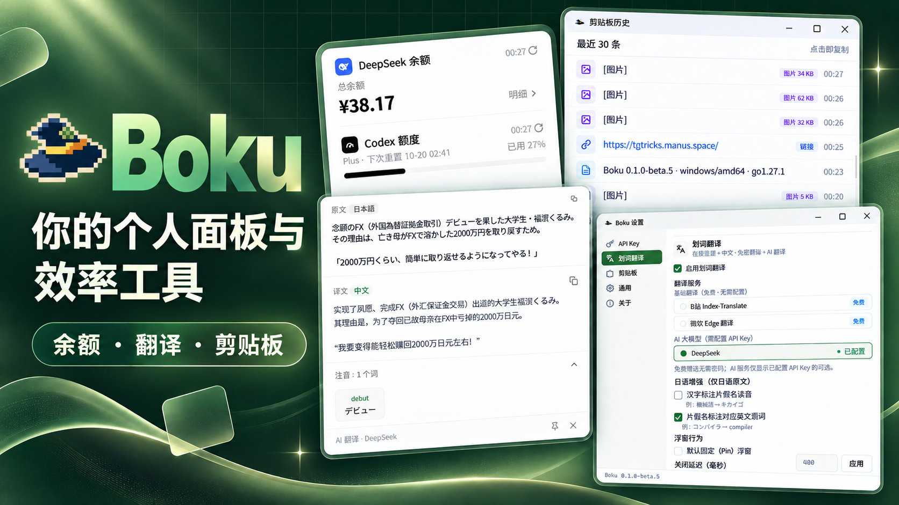

# Boku Desktop

[](https://github.com/QiYuOr2/boku-desktop/actions/workflows/ci.yml)
[](https://github.com/QiYuOr2/boku-desktop/blob/main/go.mod)
[](https://github.com/egoist/mygo)
[](./LICENSE)

<p align="center">
  
</p>

<p align="center">
  <strong>你的个人面板与效率工具。</strong><br>
  常驻托盘，点一下看状态，按一下用工具，然后继续专注。
</p>

<p align="center">
  <a href="https://github.com/QiYuOr2/boku-desktop/releases/latest">下载最新版本</a>
  ·
  <a href="https://github.com/QiYuOr2/boku-desktop/issues">反馈问题或建议</a>
</p>

## 为什么是 Boku

每天都会反复打开的网页、命令行和小工具，不应该散在各处。Boku 把它们收进一个轻量的托盘入口：

- **看状态**：在一张悬浮小卡片中查看 API 余额和 Codex 额度。
- **随手处理**：划词即译，复制过的内容随时找回。
- **不打断工作**：没有常驻主窗口；左键点托盘图标开合面板，用完即走。

## 已有能力

| 你想做什么 | Boku 如何完成 |
| --- | --- |
| 查看 DeepSeek 余额 | 填入自己的 API Key，查看余额、赠金与充值余额。 |
| 查看 Codex 额度 | 读取本机已登录的 Codex CLI 状态，无需再次填写 Key。 |
| 快速翻译选中的文字 | 按 <kbd>Ctrl</kbd>/<kbd>⌘</kbd> + <kbd>Shift</kbd> + <kbd>T</kbd>，使用免费翻译或已配置的 AI 服务；日文可按需显示注音。 |
| 翻译屏幕上的文字或图片 | 点快捷窗口的截图按钮，或按 <kbd>Ctrl</kbd>/<kbd>⌘</kbd> + <kbd>Alt</kbd> + <kbd>T</kbd>，框选区域；DeepSeek 或支持视觉输入的自定义服务直接返回原文与译文。 |
| 识别屏幕上的二维码 | 点截图按钮左侧的二维码按钮，框选二维码，在本地解析为文本并复制；不联网，也不依赖翻译服务。 |
| 自动更新 | 启动后检查 GitHub Release，后台下载并校验新版本；设置 > 关于出现「重启并更新」。 |
| 找回刚才复制的内容 | 自动保留文本、链接、JSON、代码、文件和图片；点一条即可复制回剪贴板。 |
| 管理设置与凭据 | 在一个设置窗口中管理 API Key、翻译、剪贴板、外观与应用信息。 |

## 三步开始

1. 在 [Releases](https://github.com/QiYuOr2/boku-desktop/releases/latest) 下载适合平台的安装包。Windows 可选择安装包或免安装版；macOS 使用通用 DMG。
2. 启动 Boku。它会安静地驻留在系统托盘，不会抢占桌面。
3. 左键点击托盘图标打开个人面板；选中文字后按默认快捷键即可翻译。

首次使用不需要账号。免费翻译引擎可以直接使用；DeepSeek 余额和 AI 翻译只在你主动配置自己的凭据后才会启用。

> macOS 首次打开未公证的 App 时，系统可能显示安全提示。请从本仓库的 Release 下载，并通过 Finder 中的“右键 → 打开”完成首次确认。

## 数据、网络与隐私

- Boku 没有项目服务器，也没有账户系统；面板请求只发往你选择的数据服务，更新检查只读取 GitHub Release。
- 凭据保存在本机的明文 `secrets.json` 文件中。请不要把该文件同步到不可信的位置。
- 凭据不会显示在界面、日志或错误信息里。

## 从源码构建

需要 **Go 1.27 或更新**。

```bash
git clone https://github.com/QiYuOr2/boku-desktop.git
cd boku-desktop

go tool mygo dev        # 开发：构建并启动；改动 .go 后自动重建重启
go tool mygo build      # 生产构建与打包，产物在 build/<os>-<arch>/
go tool mygo doctor     # 检查本机环境
```

程序可在 `CGO_ENABLED=0` 下编译，不依赖 cgo。若 Go 模块下载较慢，可以设置代理：

```bash
go env -w GOPROXY=https://goproxy.cn,direct
```

提交前请运行与 CI 相同的检查：

```bash
gofmt -l .              # 应无输出
go vet ./...
go tool mygo vet .      # 检查 MyGo 视图与 goroutine 的常见错误
go test ./...
```

## License

[MIT](./LICENSE)
