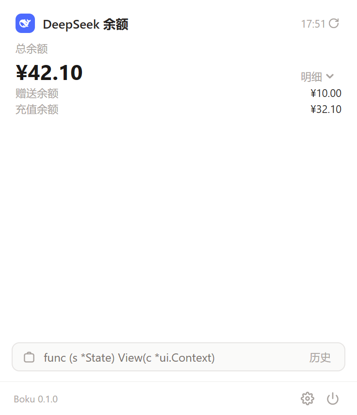
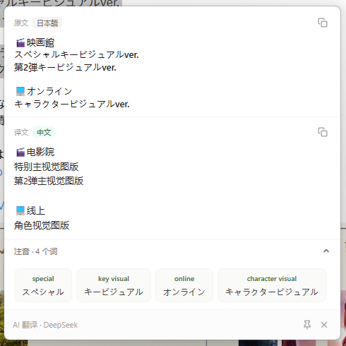
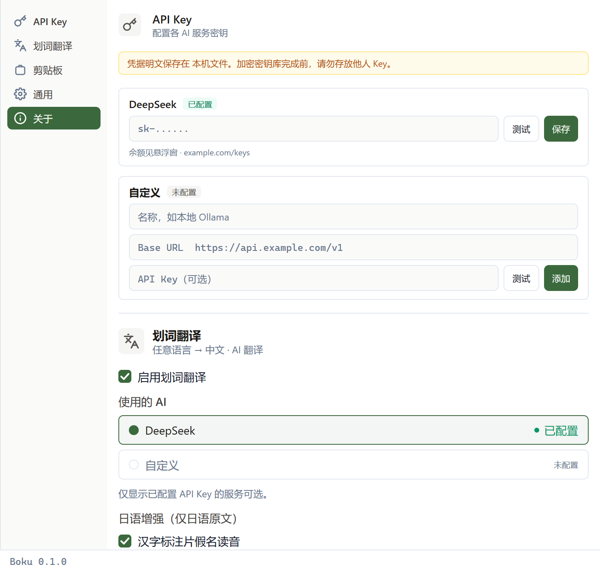

# Boku Desktop

[](https://github.com/QiYuOr2/boku-desktop/actions/workflows/ci.yml)
[](https://github.com/QiYuOr2/boku-desktop/blob/main/go.mod)
[](https://github.com/egoist/mygo)
[](./LICENSE)

用 Go 与 [MyGo](https://github.com/egoist/mygo) 写的桌面工具，常驻系统托盘。
点托盘图标弹出一个窗口，里面是两类内容：面板与工具。

**面板**——查看第三方服务的余额与额度：

| 面板 | 说明 |
| --- | --- |
| DeepSeek 余额 | 余额、赠金、充值余额 |
| Codex 额度 | 读本机 Codex CLI 的登录，不用再填一次 key |

**工具**：

| 工具 | 说明 |
| --- | --- |
| 划词翻译 | 选中文字后按快捷键翻译，支持 OpenAI 协议与自定义后端 |
| 剪贴板历史 | 记录复制过的文本与图片，可搜索、可回填 |

设置窗口用来配置每个面板与工具的凭据和行为。

<p align="center">
  
  
  
</p>

## 状态

v0.1.0，早期开发中，接口和数据结构都可能变。

尚未实现：

| 能力 | 说明 |
| --- | --- |
| 软件订阅 / 读书时长 / 游戏时长 | 计划中的面板 |
| JSON 格式化等工具 | 计划中 |

已知限制：

- **凭据是明文**：`secrets.json`（权限 0600）。Windows 上这不等于 ACL，
  所以它**不是安全边界**；这是最终形态，不会有加密版本（[security.md](../../docs/security.md) §1），
  设置界面里已经如实告诉用户。
- 快照缓存只在内存：重启后的第一次打开需要联网，之后会显示上一次的结果并标注为旧数据。
- 只有一个全局快捷键（划词翻译）。用来开合悬浮窗的 `Ctrl+Alt+B` 还没做，
  目前靠点托盘左键打开。

## 构建

需要 **Go 1.27 或更新**。

```bash
git clone https://github.com/QiYuOr2/boku-desktop.git
cd boku-desktop

go tool mygo dev        # 开发：构建 dev 版本、启动，改动 .go 后重建重启
go tool mygo build      # 生产构建与打包，产物在 build/<os>-<arch>/
go tool mygo doctor     # 检查本机环境
```

程序在 `CGO_ENABLED=0` 下编译，没有需要 cgo 的依赖。

依赖从 Go 模块代理下载。如果拉取慢，可以换一个：

```bash
go env -w GOPROXY=https://goproxy.cn,direct
```

## 开发

提交前跑这四条，CI 跑的是同一套：

```bash
gofmt -l .              # 应无输出
go vet ./...
go tool mygo vet .      # 检查把构建期 element 存进状态或 goroutine 的写法
go test ./...
```

改界面时不必开窗口——MyGo 的 `ui.NewTester` 能在内存里渲染并模拟输入：

```go
tt := ui.NewTester(app.View, 320, 300)
_ = tt.Click("刷新")
if !tt.HasText("¥42.10") { /* ... */ }
```

视图与布局不写像素断言测试，靠运行时验收。

## 架构

单个 Go 进程，按**功能**分包：每个功能自己拥有它的服务、它的存储与它认识的数据源。
跨功能共享的只有三样：领域契约、纯函数、外部世界适配。

```text
internal/domain            实体、值对象、端口接口、错误码、Clock。零依赖
internal/kit               纯函数（金额、文本、语言、脱敏）。只依赖 domain
internal/platform          外部世界适配：httpc / sysclip / selection / atomicfile
internal/contract/<厂商>    厂商身份常量：providerId、凭据 key、申请页
        ↑
internal/panel             功能：面板（服务 + 注册表 + 每个厂商一棵子树）
internal/clipboard         功能：剪贴板历史（服务 + 轮询 + 历史与图片存储）
internal/translate         功能：划词翻译（openai 协议 + 各后端）
internal/credential        功能：凭据（服务 + 存储）
internal/settings          功能：应用设置的存储
        ↑
internal/app               Presentation：视图、窗口、托盘、快捷键
main.go                    唯一装配点
```

三条规则：

1. **功能之间不互相 import。** 它们只在 `internal/domain` 的接口上相遇
   （`SecretStore`、`ClipboardDevice`…），由 `main.go` 注入实现。
2. **依赖方向单向。** 功能可以依赖 `domain` / `kit` / `platform` / `contract`，
   反过来一律不许；`domain` 与 `contract/*` 不 import 任何其它 internal 包。
3. **出网收口。** 只有 `internal/platform/httpc` 与数据源包引入 `net/http`。

第三方数据结构的差异收口在每个数据源自己的包里，取数与映射成对存在：

```text
internal/panel/<厂商>/client.go   Fetch(HTTP)  → FetchResult(原始 JSON)
internal/panel/<厂商>/adapter.go  Normalize    → Snapshot(统一指标)
```

映射必须是纯函数——不读时钟、不开文件、不发请求——因此可以离线测试，并且
必须有包含**畸形响应**的用例：断言返回 `ErrProviderBadResponse`，
而不是把失败当成 `0`。

新增一个数据源的完整流程写在 [`AGENTS.md`](./AGENTS.md)。

## 界面约定

MyGo 的 UI 是即时模式，视图每帧重新构建。几条硬约束：

- 视图函数必须无副作用；查询事件用 `.Clicked()` / `.Changed()` / `.Submitted()`，
  或用 `.OnClick(...)` 把动作延后到本帧构建结束。
- 控件值用 `.Bind(&state.Field)` 绑定到状态字段。
- 需要跨帧身份的控件用 `c.Key(...)`，**必须在构造之前**设到 context 上——
  元素构建完再调 `.Key()` 会 panic。
- 构建期的 `ui.Element` 只在一帧内有效，不要存进状态或传给 goroutine。
- **按钮、菜单、托盘与全局快捷键的回调都在主线程**：只启动 goroutine，
  绝不等待网络；后台结果用 `Window.Update` 回到主线程后再写状态。

托盘与悬浮窗还有四条容易踩的约束：

1. 默认不挂托盘菜单，否则左键永远点不出悬浮窗（有菜单时左键会弹菜单）。
2. 每次开合都新建 flyout；复用 `Hidden` 的窗口不会被重新定位到托盘旁。
3. 必须注册 `App.OnWindowAllClosed`，否则悬浮窗一关进程就退出。
4. 托盘图标用 `go:embed`，不运行时读盘。

## 数据与凭据

- 数据库与凭据都在系统的用户数据目录下（`mygo.App.Path(mygo.PathUserData)`）。
- 数据库只保存凭据的引用（`secretRef`），**不保存明文**。
- 凭据存明文 `secrets.json`（权限 0600），不加密——见上面「已知限制」。
- 日志写在用户数据目录下的 `logs/`，一天一个文件，保留最近 30 天。
- 日志与错误信息输出凭据前必须 `redact`：错误里只允许出现 key 名，不允许出现值。
- 测试只用合成的假值，不使用真实凭据。

## 目录

```text
main.go        装配：应用名、生命周期监听、托盘、悬浮窗。唯一装配点
mygo.json      应用名、identifier、版本、产物目录
resources/     icon.png：应用图标，构建时打进应用包
internal/      app / domain / kit / platform / contract / panel / clipboard
               / translate / credential / settings / logging
testdata/      适配器测试用的原始响应样本
```

## License

[MIT](./LICENSE)
